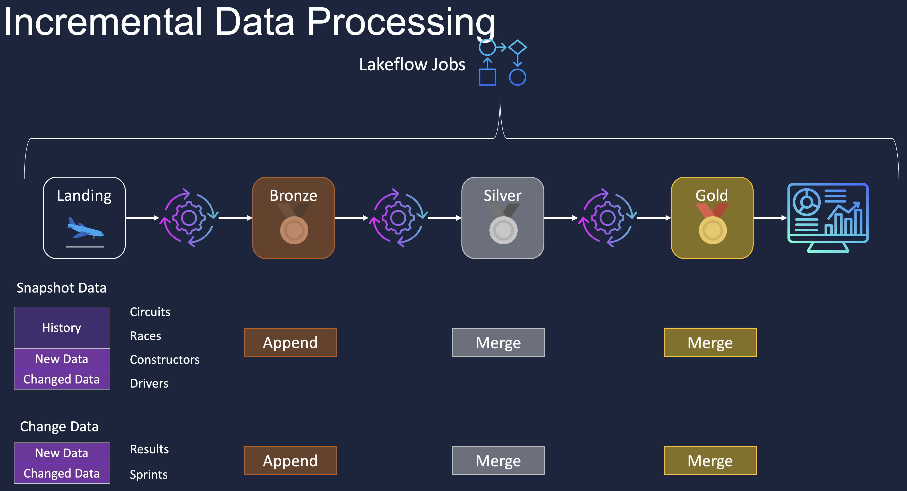
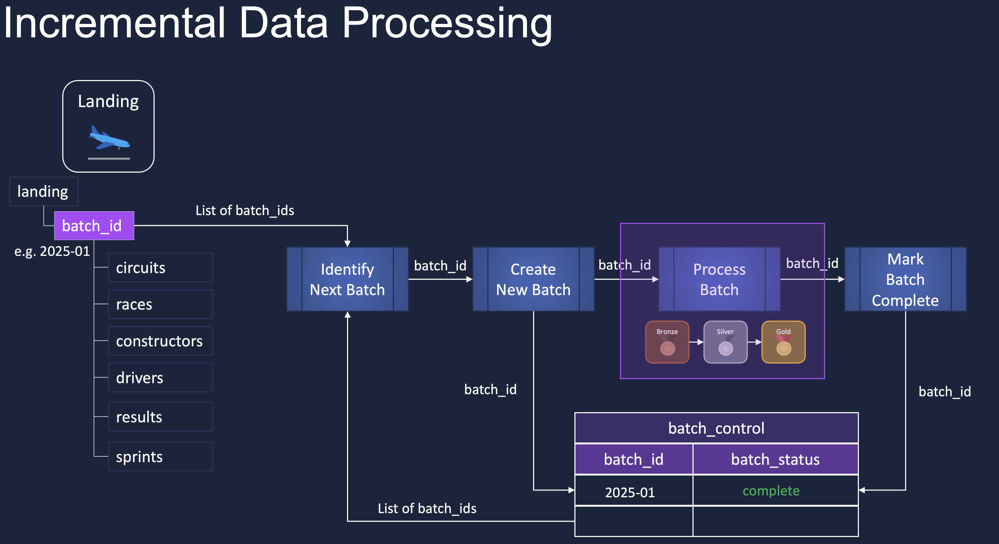
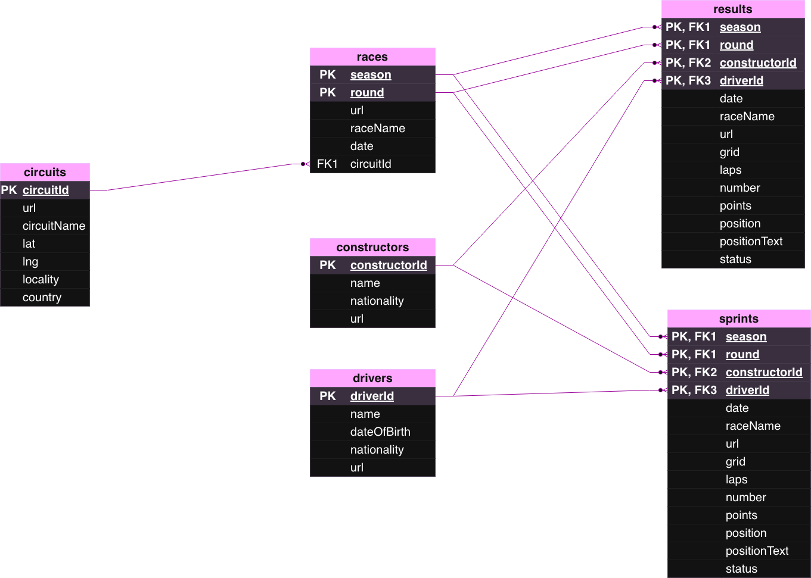
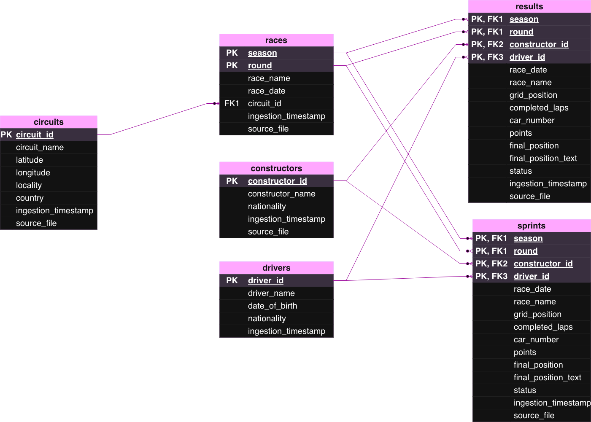
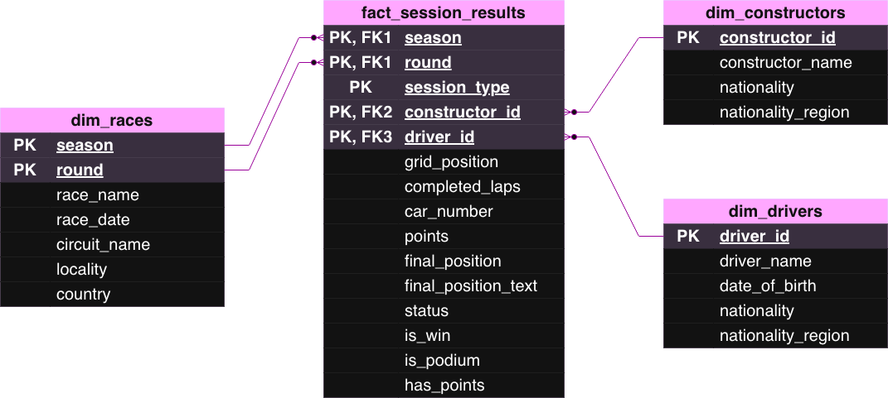

# Formula 1 Lakehouse

A batch-incremental lakehouse for historical Formula 1 race data, implemented on Databricks using the medallion architecture pattern. Source files arrive in a landing zone as dated batches and are processed through bronze, silver, and gold layers. The gold layer exposes a star schema over session results for analytical reporting.

## Architecture



The pipeline consists of four stages: landing, bronze, silver, and gold. Orchestration is handled by Lakeflow Jobs.

Write behavior differs by entity type:

- **Snapshot entities** (circuits, races, constructors, drivers) deliver full history plus new and changed records per batch. Records are appended to bronze and merged into silver and gold.
- **Change-data entities** (results, sprints) deliver only new and changed records per batch. Records are appended to bronze and merged into silver and gold.

Bronze is append-only to preserve full source lineage. Silver and gold use Delta Lake `MERGE` for idempotent upserts, which allows any batch to be reprocessed without producing duplicates.

## Incremental Processing



Processing is controlled by a `batch_control` table (`batch_id`, `batch_status`). Each run executes four steps:

1. **Identify next batch** — compare batch identifiers in the landing zone (e.g., `2025-01`) against completed entries in `batch_control`.
2. **Create new batch** — register the batch in `batch_control` with a pending status.
3. **Process batch** — execute bronze, silver, and gold transformations for that batch only.
4. **Mark batch complete** — update `batch_status` to `complete`.

Because each run processes exactly one registered batch and downstream writes are merges, the pipeline is restartable at any step and safe to backfill.

## Data Model

### Raw / Landing



Six source entities: `circuits`, `races`, `constructors`, `drivers`, `results`, and `sprints`. The source schema uses mixed-case identifiers and retains source-specific fields such as URLs.

### Silver



Silver standardizes the raw schema: column names are normalized to snake_case, data types are enforced, and two audit columns — `ingestion_timestamp` and `source_file` — are added to every entity for lineage and replay support. Primary and foreign key relationships match the source model.

### Gold



Gold is a star schema centered on `fact_session_results`, a fact table at session grain with a composite key of `season`, `round`, `session_type`, `constructor_id`, and `driver_id`. Measures include grid position, completed laps, points, and final position, along with derived flags (`is_win`, `is_podium`, `has_points`) that simplify downstream aggregation. Three conformed dimensions — `dim_races`, `dim_drivers`, and `dim_constructors` — support slicing by race, driver, and team attributes, including an enriched `nationality_region` grouping.

## Repository Structure

```javascript
/
├── notebooks/
│   ├── bronze/          # append-only ingestion from landing
│   ├── silver/          # standardization, typing, merge upserts
│   └── gold/            # star schema build, fact and dimension merges
├── control/             # batch_control DDL and batch management logic
├── data/                # sample source files
└── docs/                # architecture diagrams and ERDs
```

## Running the Project

Prerequisites: a Databricks workspace with Unity Catalog and access to Lakeflow Jobs.

1. Place a batch of source files (YAML, CSV, Parquet) under the landing path using a `YYYY-MM` batch identifier.
2. Run the Lakeflow job, or execute the notebooks in order: bronze, silver, gold.
3. Query the gold schema for reporting, or connect a BI tool to the gold catalog.

## Data Source

Historical Formula 1 data from the public Ergast-compatible API, covering circuits, races, constructors, drivers, race results, and sprint results.
